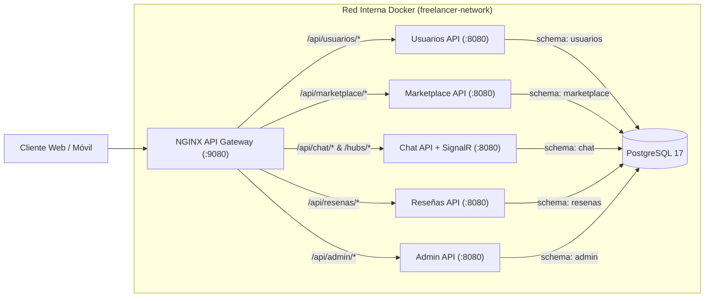

# 🚀 CodeBridge / TalentBridge — Backend API


Plataforma backend basada en **arquitectura de microservicios** para la vinculación de talento universitario (**Estudiantes**) con proyectos y oportunidades reales publicadas por **Clientes**, contando con herramientas integrales de contratación, mensajería en tiempo real, reputación y gobernanza (**Administración**).

Construido con **.NET 10 (ASP.NET Core Web API)** siguiendo principios de **Clean Architecture**, **CQRS (Command Query Responsibility Segregation)**, **Domain-Driven Design (DDD)** y contenedorización completa con **Docker Compose** y **NGINX** como API Gateway.

---

## 📑 Tabla de Contenidos

- [Arquitectura del Sistema](#-arquitectura-del-sistema)
- [Microservicios del Ecosistema](#-microservicios-del-ecosistema)
- [Stack Tecnológico](#-stack-tecnológico)
- [Seguridad y Buenas Prácticas](#-seguridad-y-buenas-prácticas)
- [Estructura del Proyecto](#-estructura-del-proyecto)
- [Configuración y Puesta en Marcha](#-configuración-y-puesta-en-marcha)
- [Variables de Entorno](#-variables-de-entorno)
- [Referencia de Endpoints (API Gateway)](#-referencia-de-endpoints-api-gateway)
- [Pruebas Automatizadas](#-pruebas-automatizadas)
- [Despliegue y CI/CD](#-despliegue-y-cicd)

---

## 🏛️ Arquitectura del Sistema

El backend está diseñado como un ecosistema distribuido de **5 microservicios independientes** detrás de un **API Gateway (NGINX)** que unifica el punto de entrada HTTP y el enrutamiento de WebSockets.



### Principios Arquitectónicos por Microservicio

Cada microservicio implementa **Clean Architecture** estructurada en 4 capas desacopladas:

1. **`Domain`**: Entidades de negocio ricas, invariantes de dominio, enumeraciones y excepciones de negocio sin dependencias externas.
2. **`Application`**: Casos de uso modelados mediante **CQRS** (`Commands` y `Queries`) orquestados con **MediatR**, validadores con **FluentValidation** ejecutados automáticamente en un pipeline (`ValidationBehavior<TRequest, TResponse>`) y contratos/interfaces (`ICurrentUserService`, repositorios y clientes HTTP).
3. **`Infrastructure`**: Persistencia con **Entity Framework Core 10** y **Npgsql**, migraciones independientes por esquema, servicios criptográficos (`BCrypt`, `JWT`, `zxcvbn`, `HIBP`), envío de correos (`MailKit`), y clientes HTTP con propagación automática de token (`JwtForwardingHandler`).
4. **`Api`**: Controladores REST ligeros que delegan directamente al `IMediator`, configuración de inyección de dependencias, autenticación/autorización, Hubs de SignalR y middleware centralizado de manejo de errores (`ExceptionHandlingMiddleware`).

> [!IMPORTANT]
> **Aislamiento de Datos entre Microservicios:** Todos los servicios comparten la instancia de PostgreSQL pero operan sobre **esquemas lógicos independientes** (`usuarios`, `marketplace`, `chat`, `resenas`, `admin`). No existen claves foráneas cruzadas entre esquemas; la comunicación e integridad entre dominios se resuelve mediante llamadas HTTP internas autenticadas.

---

## 🧩 Microservicios del Ecosistema

| Microservicio | Ruta en Gateway | Esquema BD | Responsabilidades Principales |
| :--- | :--- | :--- | :--- |
| **👤 Usuarios API** | `/api/usuarios/` | `usuarios` | Registro e inicio de sesión con JWT, recuperación de contraseña por correo (SMTP), gestión de perfiles de **Estudiante** y **Cliente**, portafolio de proyectos estudiantiles y directorio de búsqueda de talento. |
| **🛒 Marketplace API** | `/api/marketplace/` | `marketplace` | Gestión del ciclo de vida de ofertas/proyectos (creación, publicación, edición, cierre y cancelación), catálogo relacional de habilidades técnicas y transversales, postulaciones de estudiantes y administración de contratos. |
| **💬 Chat API** | `/api/chat/` | `chat` | Mensajería instantánea en tiempo real mediante **SignalR** (`/api/chat/hubs/chat`) y endpoints REST para gestión de conversaciones vinculadas a proyectos, postulaciones o contratos. |
| **⭐ Reseñas API** | `/api/resenas/` | `resenas` | Evaluación bidireccional (**Cliente ↔ Estudiante**) asociada a contratos, consulta de reseñas emitidas y cálculo de reputación consolidada por usuario. |
| **🛡️ Admin API** | `/api/admin/` | `admin` | Panel de métricas globales de la plataforma, moderación de usuarios (suspensión y reactivación), moderación de ofertas (ocultamiento y restauración) y bitácora de auditoría administrativa inmutable. |

---

## 🛠️ Stack Tecnológico

| Categoría | Tecnología / Librería | Propósito |
| :--- | :--- | :--- |
| **Runtime & Framework** | .NET 10 / ASP.NET Core Web API | Plataforma principal de ejecución y construcción de servicios REST. |
| **Base de Datos** | PostgreSQL 17 (Alpine) | Motor relacional con aislamiento por esquemas (`schemas`). |
| **ORM** | Entity Framework Core 10 + Npgsql | Mapeo objeto-relacional y aplicación automática de migraciones al inicio. |
| **Arquitectura & CQRS** | MediatR 14 + FluentValidation | Desacoplamiento de comandos/consultas y validación declarativa en pipeline. |
| **Tiempo Real** | ASP.NET Core SignalR | Comunicación bidireccional por WebSockets para el servicio de Chat. |
| **Seguridad & Criptografía** | JWT Bearer, BCrypt.Net-Next, zxcvbn-core, HIBP API | Tokens firmados (`HS256`), hashing de contraseñas, cálculo de entropía y verificación contra contraseñas filtradas. |
| **Correo Electrónico** | MailKit (SMTP) / Mailpit (Desarrollo) | Envío de enlaces seguros de recuperación de contraseña. |
| **Gateway & Red** | NGINX (Alpine) + Cloudflare Tunnel | Reverse proxy, balanceo hacia upstreams internos y soporte WebSocket. |
| **Testing** | xUnit + Moq | Pruebas unitarias de handlers, validadores, reglas de dominio y migraciones. |

---

## 🔒 Seguridad y Buenas Prácticas

- **Autenticación JWT Unificada**: Todos los microservicios validan la firma simétrica (`HMAC-SHA256`, clave mínima de 32 bytes), el `Issuer`, el `Audience` y la vigencia sin margen de desfase (`ClockSkew = TimeSpan.Zero`).
- **Control de Acceso Basado en Roles (RBAC)**: Protección granular por rol (`Estudiante`, `Cliente`, `Administrador`) en endpoints y verificación de propiedad del recurso en los handlers mediante `ICurrentUserService`.
- **Protección Avanzada de Contraseñas**:
  - Hashing seguro utilizando **BCrypt**.
  - Validación de fortaleza y entropía mediante **zxcvbn**.
  - Verificación de contraseñas comprometidas usando el modelo *k-Anonymity* de la API de **Have I Been Pwned (HIBP)** sin exponer nunca la contraseña en texto plano.
- **Recuperación Segura de Cuenta**: Tokens de restablecimiento con expiración configurable y almacenamiento seguro.
- **Gestión de Secretos**: Ninguna credencial, clave privada ni token se almacena en el código fuente; toda la configuración sensible se inyecta mediante variables de entorno (`.env`).

---

## 📂 Estructura del Proyecto

```text
freelancer-app-backend/
├── .github/workflows/          # Pipelines de integración y despliegue continuo
├── nginx/
│   └── nginx.conf              # Configuración del API Gateway y ruteo inverso
├── Usuarios/                   # Microservicio de Identidad, Perfiles y Portafolios
│   ├── Usuarios.Domain/
│   ├── Usuarios.Application/
│   ├── Usuarios.Infrastructure/
│   ├── Usuarios.Api/
│   └── Usuarios.Tests/
├── Marketplace/                # Microservicio de Ofertas, Skills, Postulaciones y Contratos
│   ├── Marketplace.Domain/
│   ├── Marketplace.Application/
│   ├── Marketplace.Infrastructure/
│   ├── Marketplace.Api/
│   └── Marketplace.Tests/
├── Chat/                       # Microservicio de Mensajería y Hub SignalR
│   ├── Chat.Domain/
│   ├── Chat.Application/
│   ├── Chat.Infrastructure/
│   ├── Chat.Api/
│   └── Chat.Tests/
├── Resenas/                    # Microservicio de Calificaciones y Reputación
│   ├── Resenas.Domain/
│   ├── Resenas.Application/
│   ├── Resenas.Infrastructure/
│   ├── Resenas.Api/
│   └── Resenas.Tests/
├── Admin/                      # Microservicio de Moderación, Métricas y Bitácora
│   ├── Admin.Domain/
│   ├── Admin.Application/
│   ├── Admin.Infrastructure/
│   └── Admin.Api/
├── init-db.sh                  # Script de inicialización de schemas en PostgreSQL
├── docker-compose.yml          # Orquestación completa del stack backend
├── docker-compose.smtp-test.yml# Contenedor opcional Mailpit para pruebas SMTP locales
└── .env.example                # Plantilla segura de variables de entorno
```

---

## ⚙️ Configuración y Puesta en Marcha

### Requisitos Previos

- **Docker** y **Docker Compose** (para ejecución contenedorizada completa).
- **.NET 10 SDK** (opcional, para desarrollo y ejecución de pruebas locales fuera de Docker).

### 1. Configurar Variables de Entorno

Copia el archivo de plantilla `.env.example` a `.env` en la raíz del proyecto y asigna valores seguros:

```bash
cp .env.example .env
```

> [!CAUTION]
> Nunca subas el archivo `.env` al repositorio. Asegúrate de definir una clave `JWT_KEY` de al menos **32 caracteres** y contraseñas robustas para `POSTGRES_PASSWORD`.

### 2. Levantar el Ecosistema con Docker Compose

Construye las imágenes y levanta todos los contenedores en segundo plano:

```bash
docker compose up -d --build
```

Al iniciar por primera vez:
1. **PostgreSQL** ejecuta automáticamente `init-db.sh` para crear los esquemas `usuarios`, `marketplace`, `chat`, `resenas` y `admin`.
2. Cada microservicio aplica de forma automática sus **migraciones de Entity Framework Core** sobre su respectivo esquema al arrancar.
3. Si se definieron las variables opcionales `ADMIN_INICIAL_*`, el servicio de Usuarios sembrará la cuenta administradora inicial en caso de no existir.

El **API Gateway (NGINX)** quedará disponible en:
- **URL Base Local**: `http://localhost:9080`
- **Health Check del Gateway**: `GET http://localhost:9080/health`

### 3. Servidor SMTP de Pruebas Local (Opcional)

Para probar el flujo de recuperación de contraseñas en entorno local sin utilizar un proveedor SMTP externo, puedes levantar **Mailpit**:

```bash
docker compose -f docker-compose.smtp-test.yml up -d
```

- **Puerto SMTP**: `localhost:1025`
- **Bandeja Web de Mailpit**: `http://localhost:8025`

---

## 🔐 Variables de Entorno

El archivo [`.env.example`](./.env.example) documenta todas las variables requeridas por el stack:

| Variable | Descripción | Ejemplo / Valor por Defecto |
| :--- | :--- | :--- |
| `POSTGRES_USER` | Usuario administrador de PostgreSQL | `freelancer_admin` |
| `POSTGRES_PASSWORD` | Contraseña de PostgreSQL | `<PASSWORD_SEGURO>` |
| `POSTGRES_DB` | Nombre de la base de datos compartida | `freelancer_db` |
| `*_DB_CONNECTION` | Cadenas de conexión Npgsql para cada microservicio | `Host=postgres;Port=5432;Database=freelancer_db;...` |
| `JWT_KEY` | Clave secreta compartida para firma JWT (mín. 32 bytes) | `<CLAVE_SECRETA_MIN_32_BYTES>` |
| `JWT_ISSUER` | Emisor del token JWT | `CodeBridge` |
| `JWT_AUDIENCE` | Audiencia del token JWT | `CodeBridgeUsuarios` |
| `JWT_EXPIRA_MINUTOS` | Tiempo de expiración del token en minutos | `60` |
| `SMTP_HOST` / `SMTP_PORT` | Servidor y puerto SMTP para correos transaccionales | `smtp.gmail.com` / `587` |
| `SMTP_USERNAME` / `SMTP_PASSWORD` | Credenciales de autenticación SMTP | `<USUARIO_SMTP>` / `<PASSWORD_SMTP>` |
| `PASSWORD_RESET_URL` | URL del frontend para restablecer contraseña | `http://localhost:8100/auth/restablecer-password` |
| `CORS_ALLOWED_ORIGINS` | Orígenes adicionales permitidos por CORS (separados por coma) | `https://tu-dominio-frontend.com` |
| `ADMIN_INICIAL_EMAIL` | Correo opcional para sembrar el administrador inicial | *(Opcional)* |
| `ADMIN_INICIAL_PASSWORD` | Contraseña opcional para el administrador inicial | *(Opcional)* |
| `CLOUDFLARE_TUNNEL_TOKEN` | Token para exposición segura mediante Cloudflare Tunnel | *(Opcional en local)* |

---

## 📡 Referencia de Endpoints (API Gateway)

Todas las peticiones externas ingresan a través del Gateway en `http://localhost:9080`.

### 👤 Usuarios API (`/api/usuarios`)

| Método | Ruta Gateway | Descripción | Acceso |
| :--- | :--- | :--- | :--- |
| `POST` | `/api/usuarios/Auth/registro` | Registro de nuevo usuario (`Estudiante` o `Cliente`) | Público |
| `POST` | `/api/usuarios/Auth/login` | Autenticación y emisión de token JWT | Público |
| `POST` | `/api/usuarios/Auth/recuperar-password` | Solicitud de enlace de recuperación por correo | Público |
| `POST` | `/api/usuarios/Auth/restablecer-password` | Restablecimiento de contraseña mediante token | Público |
| `GET` | `/api/usuarios/Perfiles/mi-perfil` | Obtener perfil académico y skills del estudiante | `Estudiante` |
| `POST/PUT` | `/api/usuarios/Perfiles/mi-perfil` | Crear o actualizar perfil del estudiante | `Estudiante` |
| `GET` | `/api/usuarios/Portafolios/mi-portafolio` | Listar trabajos del portafolio propio | `Estudiante` |
| `GET` | `/api/usuarios/Portafolios/estudiantes/{usuarioId}` | Consultar portafolio público de un estudiante | Público |
| `POST` | `/api/usuarios/Portafolios/trabajos` | Agregar proyecto al portafolio | `Estudiante` |
| `PUT/DELETE`| `/api/usuarios/Portafolios/trabajos/{id}` | Editar o eliminar proyecto del portafolio | `Estudiante` |
| `GET` | `/api/usuarios/clientes/mi-perfil` | Consultar perfil del cliente autenticado | `Cliente` |
| `POST/PUT` | `/api/usuarios/clientes/mi-perfil` | Crear o actualizar perfil del cliente | `Cliente` |
| `GET` | `/api/usuarios/estudiantes` | Buscar estudiantes por habilidad o carrera (paginado) | `Cliente` |

### 🛒 Marketplace API (`/api/marketplace`)

| Método | Ruta Gateway | Descripción | Acceso |
| :--- | :--- | :--- | :--- |
| `GET` | `/api/marketplace/catalogo/habilidades/categorias` | Listar categorías del catálogo de habilidades | Autenticado |
| `GET` | `/api/marketplace/catalogo/habilidades` | Listar habilidades técnicas y transversales | Autenticado |
| `GET` | `/api/marketplace/Proyectos` | Explorar oportunidades con filtros avanzados | `Estudiante` |
| `GET` | `/api/marketplace/Proyectos/{id}` | Consultar detalle completo de una oferta | Autenticado |
| `POST` | `/api/marketplace/Proyectos` | Crear una nueva oferta de proyecto | `Cliente` |
| `GET` | `/api/marketplace/Proyectos/mis-ofertas` | Listar ofertas creadas por el cliente | `Cliente` |
| `PUT` | `/api/marketplace/Proyectos/{id}` | Actualizar datos de una oferta | `Cliente` |
| `PUT` | `/api/marketplace/Proyectos/{id}/publicar` | Publicar una oferta en borrador | `Cliente` |
| `PUT` | `/api/marketplace/Proyectos/{id}/cerrar` | Cerrar recepción de postulaciones | `Cliente` |
| `PUT` | `/api/marketplace/Proyectos/{id}/cancelar` | Cancelar una oferta | `Cliente` |
| `POST` | `/api/marketplace/ofertas/{ofertaId}/postulaciones` | Postularse a una oferta publicada | `Estudiante` |
| `GET` | `/api/marketplace/postulaciones/mis-postulaciones` | Listar postulaciones realizadas por el estudiante | `Estudiante` |
| `PUT` | `/api/marketplace/postulaciones/{id}/retirar` | Retirar una postulación activa | `Estudiante` |
| `GET` | `/api/marketplace/ofertas/{ofertaId}/postulaciones` | Listar postulantes de una oferta propia | `Cliente` |
| `PUT` | `/api/marketplace/postulaciones/{id}/aceptar` | Aceptar la postulación de un estudiante | `Cliente` |
| `PUT` | `/api/marketplace/postulaciones/{id}/rechazar` | Rechazar la postulación de un estudiante | `Cliente` |
| `POST` | `/api/marketplace/contratos` | Formalizar contrato a partir de postulación aceptada | `Cliente` |
| `GET` | `/api/marketplace/contratos/mis-contratos` | Consultar contratos del usuario autenticado | `Cliente`, `Estudiante` |
| `PUT` | `/api/marketplace/contratos/{id}/finalizar` | Marcar un contrato como finalizado | `Cliente`, `Estudiante` |
| `PUT` | `/api/marketplace/contratos/{id}/cancelar` | Cancelar un contrato activo | `Cliente`, `Estudiante` |

### 💬 Chat API (`/api/chat`)

| Método / Protocolo | Ruta Gateway | Descripción | Acceso |
| :--- | :--- | :--- | :--- |
| `GET` | `/api/chat/conversaciones/mias` | Listar conversaciones activas del usuario | Autenticado |
| `POST` | `/api/chat/conversaciones` | Abrir o recuperar conversación asociada a proyecto | Autenticado |
| `GET` | `/api/chat/conversaciones/{id}/mensajes` | Obtener historial de mensajes de la conversación | Autenticado |
| `POST` | `/api/chat/conversaciones/{id}/mensajes` | Enviar mensaje vía REST y notificar por SignalR | Autenticado |
| `WS / SignalR` | `/api/chat/hubs/chat` | Conexión en tiempo real (`?access_token=<JWT>`) | Autenticado |

### ⭐ Reseñas API (`/api/resenas`)

| Método | Ruta Gateway | Descripción | Acceso |
| :--- | :--- | :--- | :--- |
| `POST` | `/api/resenas/contratos/{contratoId}/estudiante` | Calificar el desempeño del estudiante en un contrato | `Cliente` |
| `POST` | `/api/resenas/contratos/{contratoId}/cliente` | Calificar al cliente tras un contrato | `Estudiante` |
| `GET` | `/api/resenas/usuarios/{usuarioId}/reputacion` | Consultar promedio y reseñas recibidas por un usuario | Autenticado |
| `GET` | `/api/resenas/mis-resenas-emitidas` | Listar reseñas emitidas por el usuario autenticado | Autenticado |

### 🛡️ Admin API (`/api/admin`)

| Método | Ruta Gateway | Descripción | Acceso |
| :--- | :--- | :--- | :--- |
| `GET` | `/api/admin/Metricas` | Obtener métricas globales de usuarios, ofertas y reseñas | `Administrador` |
| `GET` | `/api/admin/Usuarios` | Buscar y filtrar usuarios por rol y estado | `Administrador` |
| `GET` | `/api/admin/Usuarios/{id}/historial` | Consultar historial de moderación de un usuario | `Administrador` |
| `POST` | `/api/admin/Usuarios/{id}/suspender` | Suspender cuenta de usuario con motivo registrado | `Administrador` |
| `POST` | `/api/admin/Usuarios/{id}/reactivar` | Reactivar cuenta de usuario suspendida | `Administrador` |
| `GET` | `/api/admin/Moderacion` | Listar ofertas y medidas de moderación vigentes | `Administrador` |
| `POST` | `/api/admin/Moderacion/ofertas/{id}/ocultar` | Ocultar oferta que incumpla normas de la plataforma | `Administrador` |
| `POST` | `/api/admin/Moderacion/ofertas/{id}/restaurar` | Restaurar visibilidad de una oferta oculta | `Administrador` |
| `GET` | `/api/admin/Bitacora` | Consultar bitácora inmutable de acciones administrativas | `Administrador` |

---

## 🧪 Pruebas Automatizadas

El repositorio cuenta con proyectos de pruebas unitarias basados en **xUnit** y **Moq** para validar reglas de negocio, comandos, consultas y migraciones.

Para ejecutar las pruebas de cada microservicio desde la raíz del proyecto:

```bash
dotnet test Usuarios/Usuarios.Tests/Usuarios.Tests.csproj
dotnet test Marketplace/Marketplace.Tests/Marketplace.Tests.csproj
dotnet test Chat/Chat.Tests/Chat.Tests.csproj
dotnet test Resenas/Resenas.Tests/Resenas.Tests.csproj
```

---

## 🚀 Despliegue y CI/CD

El repositorio incluye un flujo de despliegue automatizado con **GitHub Actions** (`.github/workflows/deploy.yml`) configurado para ejecutarse en un runner auto-hospedado al actualizar la rama `main`:

1. Inyecta de forma segura las variables de entorno desde GitHub Secrets (`secrets.ENV_FILE`).
2. Construye y actualiza los contenedores mediante `docker compose up -d --build`.
3. Recarga la configuración del Gateway NGINX sin tiempo de inactividad (`nginx -s reload`).
4. Limpia imágenes huérfanas con `docker image prune -f`.

> [!TIP]
> Para realizar cambios documentales en `main` sin disparar el pipeline de despliegue, incluye la etiqueta `[skip ci]` en el mensaje del commit.
